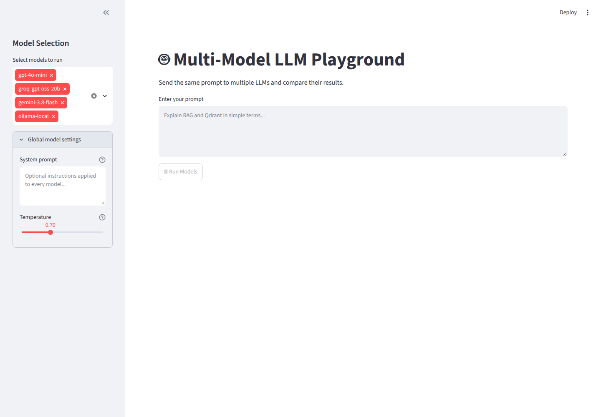

# Multi-Model LLM Playground

A Streamlit application that allows you to send the same prompt to multiple LLM providers and compare their results side-by-side.

## Features

- **Multi-Provider Support**: Compare responses from OpenAI, Groq, Google Gemini, and Ollama (local and cloud)
- **Concurrent Execution**: Run multiple models simultaneously for faster comparison
- **Performance Metrics**: View token usage, latency, and estimated costs for each model
- **Comparison Table**: Side-by-side comparison of all model responses with detailed metrics
- **Flexible Configuration**: Select any combination of registered models
- **Global Model Settings**: Apply a shared system prompt and temperature to every selected model

## Supported Models

| Registry Key | Provider | Model ID | Quality Tier |
|--------------|----------|----------|--------------|
| gpt-4o | OpenAI | gpt-4o | High |
| gpt-4o-mini | OpenAI | gpt-4o-mini | Medium |
| groq-gpt-oss-20b | Groq | openai/gpt-oss-20b | High |
| gemini-3.8-flash | Google Gemini | gemini-3.8-flash | High |
| ollama-local | Ollama (Local) | llama3.2:latest | Medium |
| ollama-cloud | Ollama (Cloud) | gemma4:31b (configurable) | High |

## Prerequisites

- Python 3.8 or higher
- For Ollama local: [Ollama](https://ollama.com) installed and running on localhost:11434
- API keys for the providers you want to use

## Installation

1. Clone the repository:
```bash
git clone <repository-url>
cd llm-model-pilot
```

2. Create a virtual environment:
```bash
python -m venv .venv
```

3. Activate the virtual environment:
```bash
# On Windows
.venv\Scripts\activate

# On macOS/Linux
source .venv/bin/activate
```

4. Install dependencies:
```bash
pip install -r requirements.txt
```

5. Configure environment variables:
```bash
cp .env.example .env
```

Edit `.env` and add your API keys:
```env
GROQ_API_KEY=your_groq_api_key
OPENAI_API_KEY=your_openai_api_key
OLLAMA_API_KEY=your_ollama_api_key
GEMINI_APIKEY=your_gemini_api_key
HF_TOKEN=your_huggingface_token
OLLAMALOCAL_API_KEY=nothing
OPENROUTER_API_KEY=your_openrouter_api_key
```

## Usage

Run the Streamlit application:
```bash
streamlit run app.py
```

The application will open in your browser at `http://localhost:8501`.

### How to Use

1. **Select Models**: In the sidebar, choose which models you want to compare
2. **Configure Global Settings**: Expand "Global model settings" to set an optional system prompt and temperature
3. **Enter Prompt**: Type your prompt in the text area
4. **Run Models**: Click the "🚀 Run Models" button
5. **View Results**: See individual model responses and a comparison table with metrics



## Configuration

### Adding New Models

To add a new model, edit `model_registry.py` and add an entry to the `MODEL_REGISTRY` dictionary:

```python
MODEL_REGISTRY: dict[str, ModelConfig] = {
    "your-model-key": ModelConfig(
        provider_name="provider",  # openai, groq, gemini, ollama_local, ollama_cloud
        model_id="model-id",
        cost_per_input_token=0.0,  # USD per token or None
        cost_per_output_token=0.0,  # USD per token or None
        average_latency_ms=1000,
        quality_tier="high",  # high, medium, or low
    ),
}
```

### Ollama Configuration

- **Local Ollama**: Set `OLLAMA_LOCAL_HOST` in `.env` (default: `http://localhost:11434`)
- **Cloud Ollama**: Set `OLLAMA_CLOUD_HOST` and `OLLAMA_CLOUD_MODEL` in `.env`

## Metrics Explained

- **Input Tokens**: Number of tokens in the prompt
- **Output Tokens**: Number of tokens in the response
- **Total Tokens**: Sum of input and output tokens
- **Latency**: Time taken for the model to generate the response (in milliseconds)
- **Cost**: Estimated cost based on token usage (USD)
- **Estimated Usage**: Flag indicating if token counts were estimated (when provider doesn't return usage data)

## Project Structure

```
llm-model-pilot/
├── app.py              # Main Streamlit application
├── model_registry.py   # Model configurations and request handling
├── .env.example        # Example environment variables
├── .env                # Your actual environment variables (not in git)
├── requirements.txt    # Python dependencies
└── README.md          # This file
```

## License

This project is provided as-is for educational and comparison purposes.
